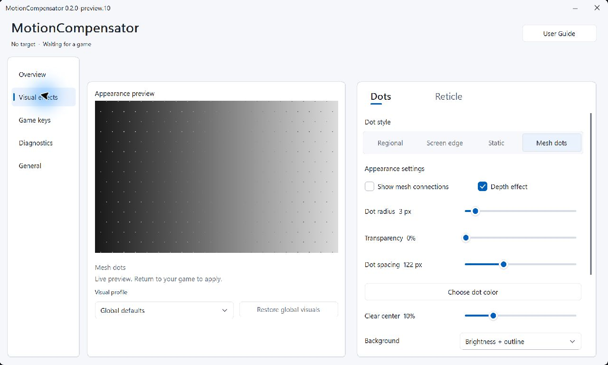
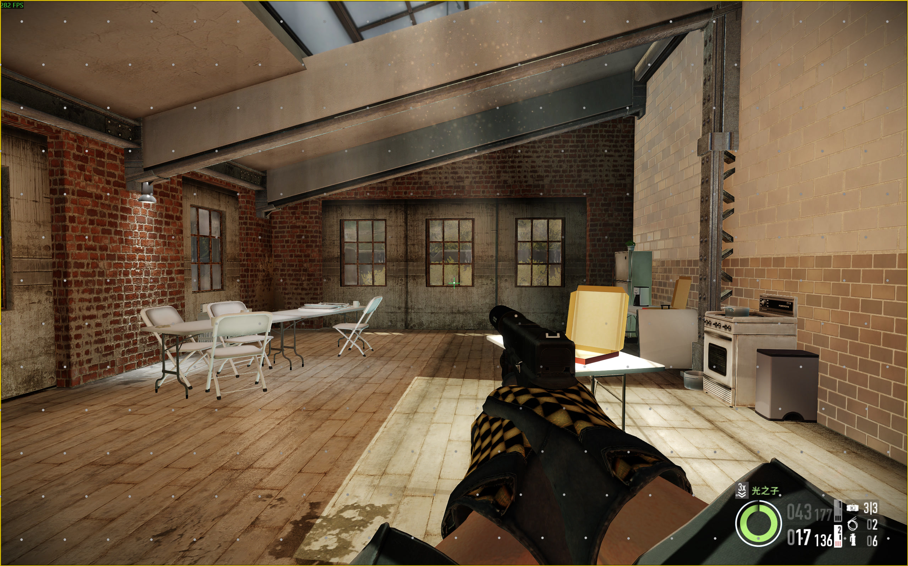
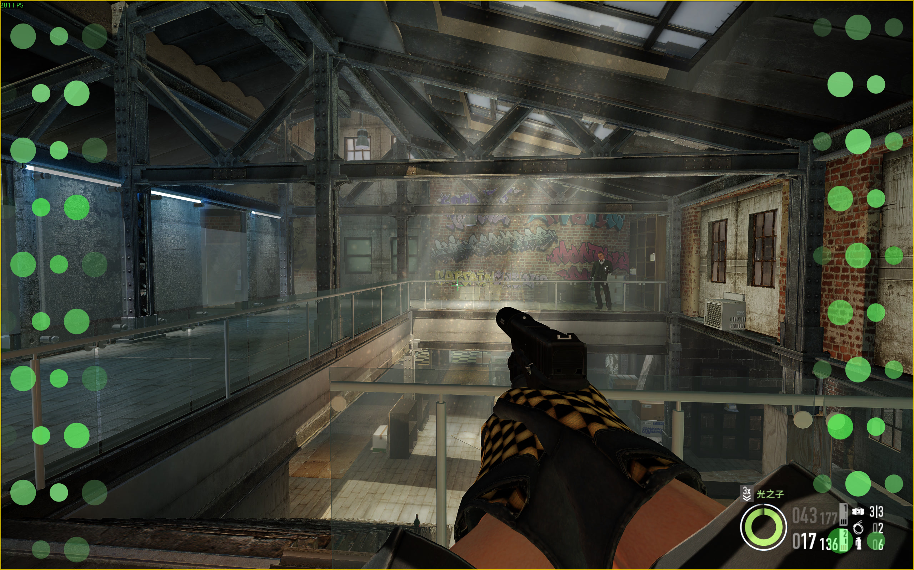
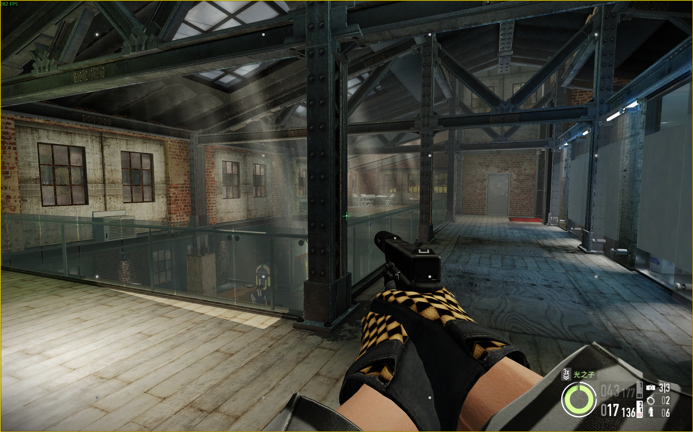
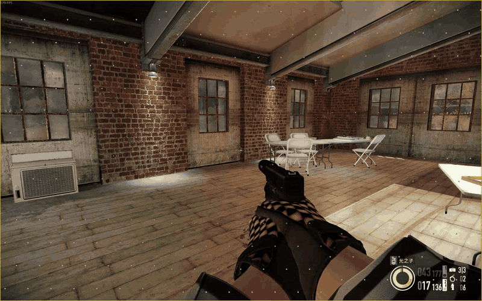

# MotionCompensator

[中文](README.md) | **English**

MotionCompensator is a Windows visual aid designed to ease 3D motion discomfort while gaming. It provides customizable dot patterns and an optional center reticle as visual references.

**Windows x64 · 0.2.0-preview.10 preview**

[Download for Windows](https://github.com/gzz312/MotionCompensator/releases/download/v0.2.0-preview.10/MotionCompensator-0.2.0-preview.10-win-x64.zip) · [Release notes and checksums](https://github.com/gzz312/MotionCompensator/releases/tag/v0.2.0-preview.10)

## Settings interface

Connect a game in Overview. Open Visual effects to choose a dot style, adjust its appearance, or save a game-specific profile. Use Game keys to record movement bindings and menu or inventory rules.



[View the built-in guide in Chinese](assets/ui/preview.10/user-guide-zh.jpg)

## Choosing a dot style

- **Static dots** give you a fixed 4×4 reference with adjustable coverage.
- **Screen-edge dots** put moving dots along selected edges, leaving room for aiming, subtitles or the game interface.
- **Regional dots** divide the screen into nine areas that respond to local motion. Use Boundary fade to soften their transitions.
- **Mesh dots** move continuously across the screen and add or remove nodes to manage spacing. Optional Depth effect uses color and dot size to distinguish expansion from contraction.

Each style saves its own appearance. Dynamic styles have adjustable motion strength and direction. Background adaptation offers brightness changes and outlines. The center reticle has separate shape, size, color and transparency settings.

## Gameplay demonstration (0.1.0-preview.1)

Three dot styles in PAYDAY 2. Click an image for a larger view. Colors, dot sizes and transparency are adjustable.

| Regional dots | Screen-edge dots | Static dots (4×4) |
| --- | --- | --- |
|  |  |  |

**Regional dots in motion (25 fps, approximately 3 seconds):**



The GIF is scaled and compressed to illustrate the dots' appearance and movement. See [media notes](assets/demo/README.md#english) for capture details.

## Getting started

1. Extract the preview package and open `MotionCompensator.exe`. Use borderless or windowed mode for the game.
2. In Overview, refresh the window list, select your game and choose Register and connect. Enable automatic connection to reconnect when a registered game is next in the foreground. Use Connect once for a single session.
3. Adjust dots or the reticle in Visual effects, then return to the game to see the overlay. Select Global defaults or a game profile below Appearance preview.
4. Use General to change language, theme or shortcuts. In Game keys, configure menu open and return keys to hide the overlay, pause it or temporarily show Static dots.

| Default shortcut | Action |
| --- | --- |
| Ctrl+Alt+F8 | Cycle dot styles |
| Ctrl+Alt+F9 | Toggle the overlay |
| Ctrl+Alt+F10 | Stop capture and automatic connection |

## Compatibility and feedback

The app captures the selected window using Windows Graphics Capture and combines optical flow with keyboard, mouse or controller input prediction locally. Plain roads, large areas of sky, cuts and foreground objects can reduce the motion visible to the app. Try different dot styles in the same scene and choose whichever feels most comfortable. [Known issues](docs/en/KNOWN-ISSUES.md)

Diagnostics shows capture, motion and mesh information. Enable Log to collect details while reproducing a problem. Log files are saved in `logs/` beside the EXE. When reporting an issue, include the app version, game, window mode, display scaling and steps to reproduce. [Report an issue](https://github.com/gzz312/MotionCompensator/issues) · [Local data and privacy](docs/en/PRIVACY.md)

## License

The [source-available and commercial integration license](LICENSE.txt) permits free use, study, modification and sharing, as well as integration into a larger commercial work with substantial independent functionality and attribution. Standalone sale, paid rebrands and separate paid unlocks of project-based functionality are prohibited.

Distributions must retain the full license and credit MotionCompensator, gzz312 and the source. The complete Chinese license terms govern; dependencies retain their own licenses. [Third-party notices](docs/en/THIRD-PARTY.md)

## Building from source

Validated with Windows x64, MSYS2 UCRT64 GCC15.2, CMake, Ninja and matching static OpenCV4.12 libraries. The MSVC build has not been validated.

```powershell
./build.ps1 -OpenCVRoot '<static OpenCV installation>'
./package.ps1 -OpenCVRoot '<static OpenCV installation>'
```

See the [build guide](docs/en/BUILD.md) for dependencies and complete instructions. [Testing](docs/en/TESTING.md) · [Changelog](docs/HISTORY.md) · [Architecture](docs/DEVELOPMENT.md)

## References and thanks

The screen-edge visual design draws on the ideas of shsr07 (拾荒散人)'s [MotionStabilizer](https://github.com/shsr07/MotionStabilizer). Thanks to the author for sharing and discussing the design. [Author's Bilibili video](https://www.bilibili.com/video/BV1saKg6XEvg/)

Staggered-layout and periodic-continuity ideas were informed by Miguel Peixoto's MotionCues, with Peregrine as a visual-anchor reference. See [design references and credits](docs/en/CREDITS.md) for sources and the code-comparison record.
