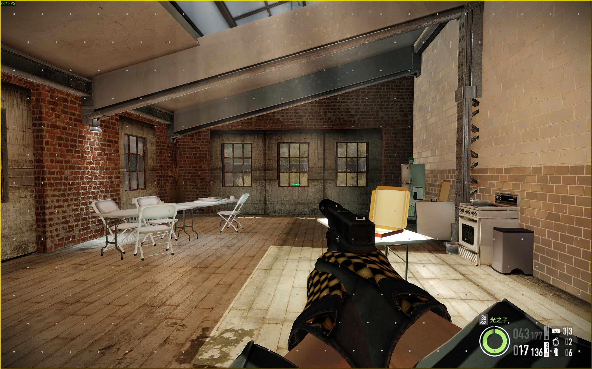
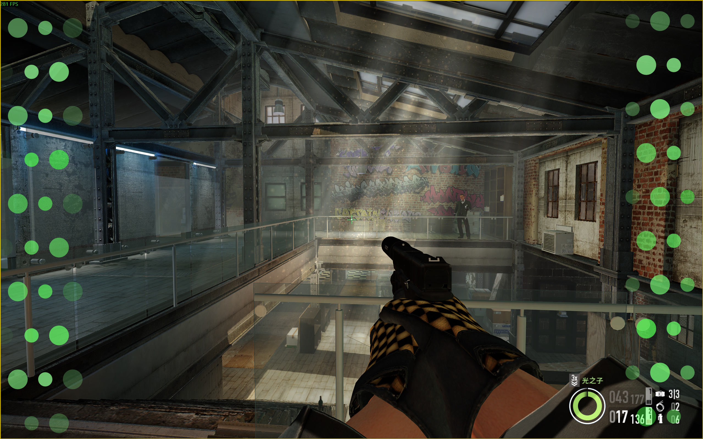
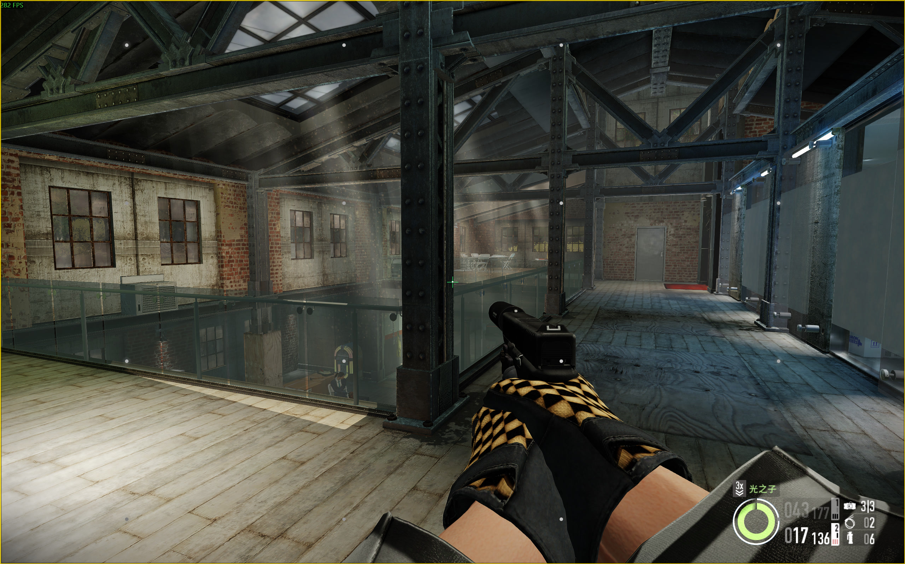
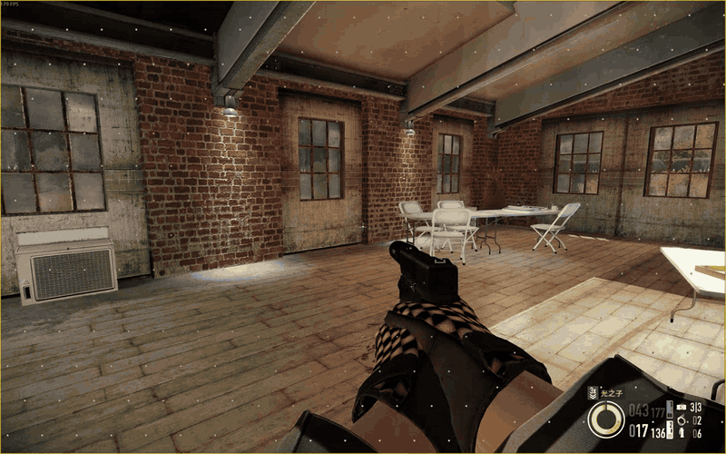

# MotionCompensator

[中文](README.md) | **English**

MotionCompensator is a Windows visual aid designed to help reduce visually induced motion sickness and discomfort during gaming, using customizable dot references and an optional central reticle. Choose regional scrolling, screen-edge scrolling or a static reference, with separate appearance settings, background brightness adaptation, Chinese/English UI and light/dark themes.

**Windows x64 · 0.1.0-preview.1 preview**

[Download the preview](https://github.com/gzz312/MotionCompensator/releases/download/v0.1.0-preview.1/MotionCompensator-0.1.0-preview.1-win-x64.zip) · [Release notes and checksums](https://github.com/gzz312/MotionCompensator/releases/tag/v0.1.0-preview.1)

## Three dot styles

- **Regional dots:** continuously scrolling regions driven by observed motion and input prediction, with staggered layouts, boundary fading and a clear center.
- **Screen-edge dots:** larger dots along selected screen edges, using scrolling, fading and size differences to present motion.
- **Static dots:** a fixed 4×4 reference, with soft halos on the outer columns. Select it through the interface or shortcut.

Adjust dot size, color, transparency and layout independently for each style. Dynamic styles also offer motion strength and direction reversal. The optional reticle supports cross and diamond-cross shapes.

## Gameplay demonstration

Three dot styles in PAYDAY 2. Click an image for a larger view. Colors, dot sizes and transparency are adjustable.

| Regional dots | Screen-edge dots | Static dots (4×4) |
| --- | --- | --- |
|  |  |  |

**Regional dots in motion (25 fps, approximately 3 seconds):**



The GIF is scaled and compressed to illustrate the dots' appearance and movement. See [media notes](assets/demo/README.md#english) for capture details.

## Getting started

1. Download and extract the preview ZIP, then run `MotionCompensator.exe`. No OpenCV or compiler installation is needed.
2. Start a game, preferably in borderless/windowed mode. Leave automatic foreground-game detection enabled and switch to a recognized game, or refresh the window list and select the game window manually.
3. Choose a dot style and adjust its appearance. The overlay appears over the target game and hides when you switch away.
4. Enable the central reticle if desired. Use the **中文 / English** button to change the interface language and the theme button to cycle light, dark and system themes.

| Shortcut | Action |
| --- | --- |
| Ctrl+Alt+F8 | Cycle dot styles |
| Ctrl+Alt+F9 | Show or hide the overlay |
| Ctrl+Alt+F10 | Stop capture and automatic connection |

The application can run as a single EXE, with instructions and license texts embedded. Close other versions first to avoid shortcut conflicts.

## Usage tips and compatibility

Dots are an optional visual aid. Experiences vary by person and game, and relief from motion discomfort is not guaranteed. Start with a short session and stop if discomfort develops.

Exclusive fullscreen can hide the overlay. Strong motion blur, camera cuts and weapon/HUD occlusion can affect motion estimation. Multi-monitor/high-DPI support and full keyboard navigation still need improvement; see [known issues](docs/en/KNOWN-ISSUES.md).

The app captures windows externally with Windows Graphics Capture and drives the dots with grayscale optical flow and keyboard/mouse/controller input prediction. It uses no hooks, DLL injection, game-memory reading or anti-cheat bypasses. Check that the target game permits external overlays before use.

## Reporting issues

Open an [Issue](https://github.com/gzz312/MotionCompensator/issues) with the application version, game/window mode, display scaling and reproduction steps.

**Log** is off by default. Enable it when diagnosing a problem, reproduce the issue, then disable it. Files are saved beside the EXE in `logs/` and are not uploaded automatically. Review process information and other local details before sharing. [Feedback and contribution guide](CONTRIBUTING.md#english) · [Local data and privacy](docs/en/PRIVACY.md)

## License

The [source-available and commercial integration license](LICENSE.txt) permits free use, study, modification and sharing, as well as integration into a larger commercial work with substantial independent functionality and attribution. Standalone sale, paid rebrands and separate paid unlocks of project-based functionality are prohibited.

Distributions must retain the full license and credit MotionCompensator, gzz312 and the source. The complete Chinese license terms govern; dependencies retain their own licenses. [Third-party notices](docs/en/THIRD-PARTY.md)

## Building from source

Validated with Windows x64, MSYS2 UCRT64 GCC15.2, CMake, Ninja and matching static OpenCV4.12 libraries. The MSVC build has not been validated.

```powershell
./build.ps1 -OpenCVRoot '<static OpenCV installation>'
./package.ps1 -OpenCVRoot '<static OpenCV installation>'
```

See the [build guide](docs/en/BUILD.md) for dependencies and complete instructions. [Testing](docs/en/TESTING.md) · [Version history (Chinese)](docs/HISTORY.md) · [Development record (Chinese)](docs/DEVELOPMENT.md)

## References and thanks

The screen-edge visual design draws on the ideas of shsr07 (拾荒散人)'s [MotionStabilizer](https://github.com/shsr07/MotionStabilizer). Thanks to the author for sharing and discussing the design. [Author's Bilibili video](https://www.bilibili.com/video/BV1saKg6XEvg/)

Staggered-layout and periodic-continuity ideas were informed by Miguel Peixoto's MotionCues, with Peregrine as a visual-anchor reference. See [design references and credits](docs/en/CREDITS.md) for sources and the code-comparison record.
