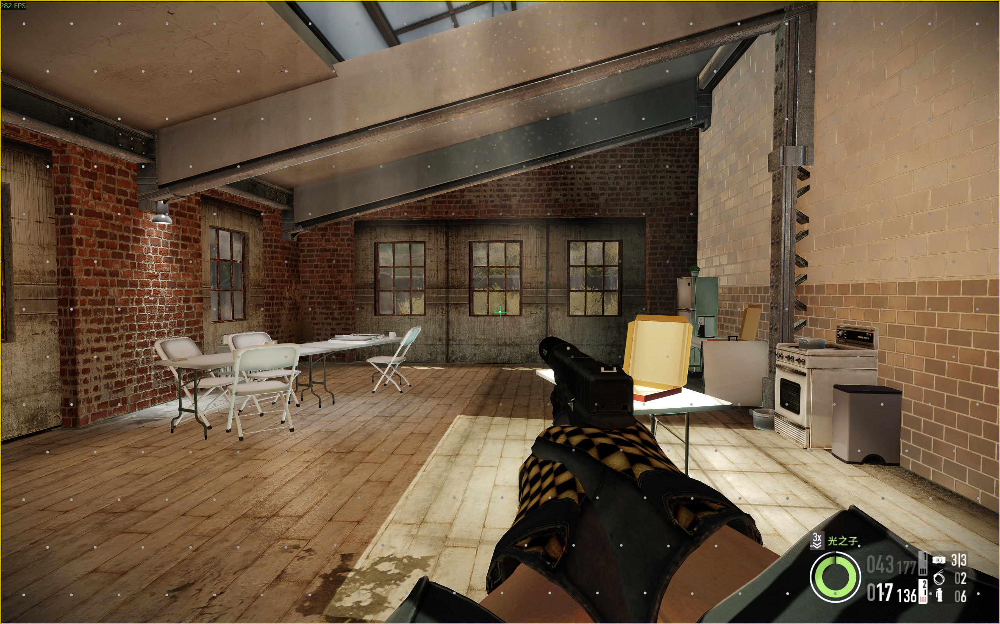
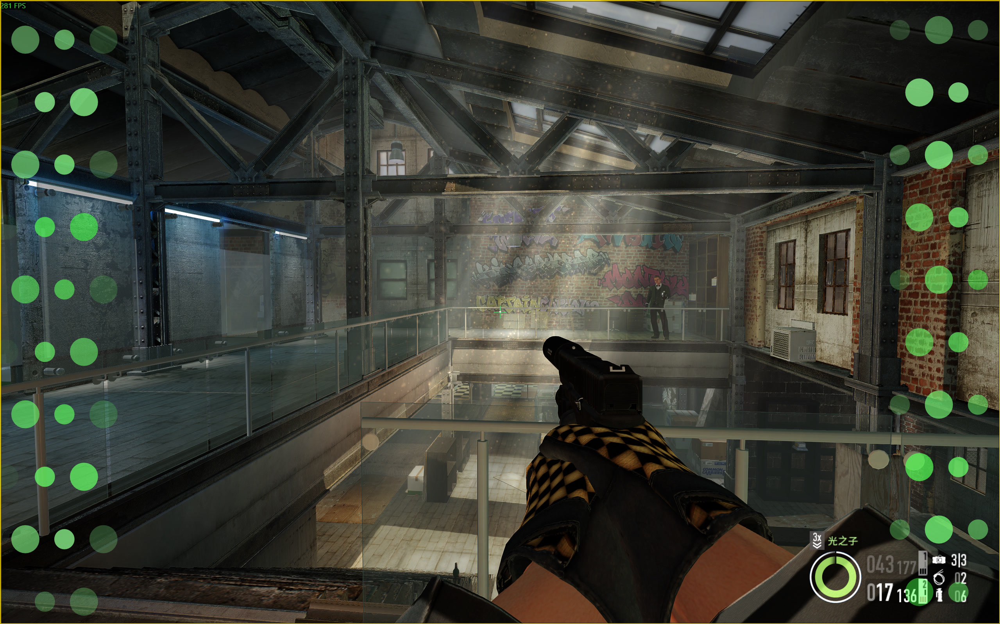
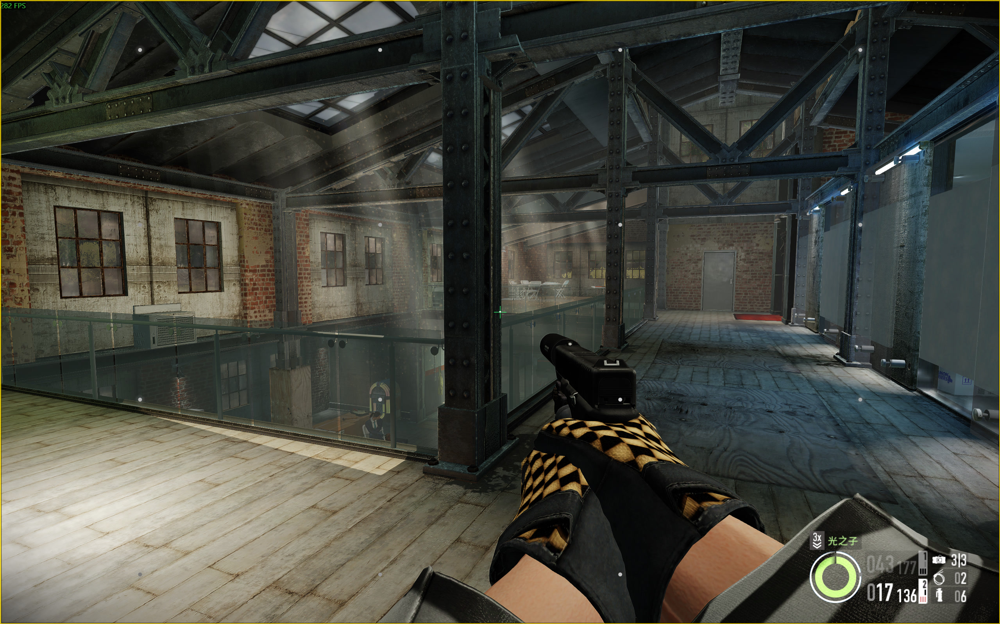
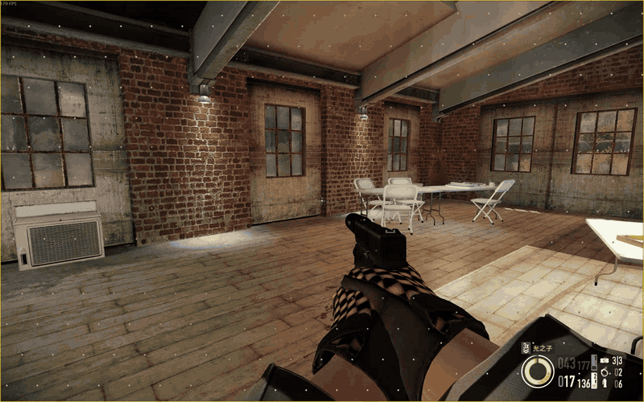

# MotionCompensator

**中文** | [English](README.en.md)

Windows原生C++20游戏晕动辅助工具，提供外部透明鼠标穿透点阵与中央准星。使用Windows Graphics Capture、灰度光流和键鼠/手柄输入预测；不使用Hook、DLL注入或游戏进程内存读取。

**当前预览版本：0.1.0-preview.1。采用自定义源码公开与商业集成许可。** 第三方组件仍按各自许可证使用。缓解效果因人、游戏和设置而异，未验证普遍疗效。

## 实机演示

以下为《收获日2》实机画面，仅展示视觉呈现，不代表已验证缓解疗效，也不是性能测试。三张对照图由用户提供，分别展示三种点阵方案。

| 分区点阵 | 屏边点阵 | 静态点阵（4×4） |
| --- | --- | --- |
|  |  |  |

点击图片可查看大图。截图展示的是拍摄时的自定义外观，不要求照搬颜色或点大小。

**分区点阵动态实录：**



GIF为**25帧/秒、约3秒**的原速片段，已缩放和压缩；由重新录制的高帧率原片生成。拍摄说明与素材权利见[素材说明](assets/demo/README.md)。

## 使用许可

允许免费使用、学习、修改和分享；允许集成到具有独立实质功能的商业作品，但须保留完整许可，并注明MotionCompensator、作者gzz312和可用来源地址。禁止独立售卖本工具或其换皮/修改版、付费插件以及单独收费解锁本项目功能。简单包装、轻微修改或捆绑不构成商业集成。商业作品的其他独立部分无需因此公开源码。

完整规则以[LICENSE.txt](LICENSE.txt)中文正文为准，英文为说明性摘要。这是自定义源码公开许可，不是MIT/GPL或OSI认可的开源许可；第三方组件保留原有许可。本许可未设置作者独立售卖的特殊例外。

## 开始使用

**0.1.0-preview.1 已公开发布。** [下载Windows x64预览包](https://github.com/gzz312/MotionCompensator/releases/download/v0.1.0-preview.1/MotionCompensator-0.1.0-preview.1-win-x64.zip)，解压后双击`MotionCompensator.exe`；其他附件与校验文件见[版本发布页](https://github.com/gzz312/MotionCompensator/releases/tag/v0.1.0-preview.1)。本地开发包仍保存在`versions/0.1.0-preview.1/`，不进入源码仓库。EXE已内置依赖、初始配置、说明、致谢和第三方许可；无需安装OpenCV或编译器。

1. 退出其他版本，启动游戏，优先使用无边框或窗口模式。
2. 保持“自动识别前台游戏”开启，切回已识别游戏；未知游戏可刷新窗口列表、选择窗口并连接。
3. 选择分区点阵、屏边点阵或静态点阵。三种方案独立保存视觉设置，动态方案不会自动切成静态。
4. 切回目标游戏查看浮层；切出游戏时隐藏。先短时体验，出现不适就停止。
5. 遇到问题时可先勾选右下角“日志”，复现后取消勾选，查看EXE旁`logs/`文件夹。日志不自动上传。

Ctrl+Alt+F8切换方案；Ctrl+Alt+F9显示/隐藏；Ctrl+Alt+F10停止采集和自动连接。

## 功能

- 分区持续滚动点阵、屏边渐隐点阵、固定4×4静态点阵。
- 交错排布、中心留空、点大小/透明度/颜色、中央十字或菱形十字准星。
- 同色相明暗适配与双层描边；屏边相邻点大小交替、尾段有限缩小、反向运动连续。
- 灰度光流9×9采样汇总至九宫格，结合输入预测及全局/局部观测。
- 调试箭头/曲线，按需日志，中文/English，浅色/深色/跟随系统主题。

## 当前限制

真实游戏体验主要由用户在PAYDAY 2等场景中对照。自动检查不能证明疗效或所有游戏兼容性。独占全屏、模糊/切镜、遮挡、输入意图与实际角色状态不一致等情况仍可能影响表现。多屏/高DPI、全部控件键盘导航、长期稳定性尚需更多测试。详见[已知问题](docs/KNOWN-ISSUES.md)。

## 从源码构建

需要Windows、C++20编译器、CMake、Ninja、与编译器匹配的OpenCV4.12静态core/imgproc/video。已验证MSYS2 UCRT64 GCC15.2；MSVC路径尚未验证。

```powershell
./build.ps1 -OpenCVRoot '<OpenCV静态安装目录>'
./package.ps1 -OpenCVRoot '<OpenCV静态安装目录>'
```

工具应在PATH中，也可显式传入`-Compiler`和`-ToolsRoot`。依赖缓存、构建产物、日志及旧版不进入源码仓库。完整步骤见[构建说明](docs/BUILD.md)。

## 使用说明、参考与记录

- [预览验证记录](docs/RELEASE-PREVIEW.md) · [贡献与问题反馈](CONTRIBUTING.md)
- [已知问题](docs/KNOWN-ISSUES.md) · [测试与反馈](docs/TESTING.md) · [本地数据与隐私](docs/PRIVACY.md)
- [设计参考与致谢](docs/CREDITS.md) · [第三方许可说明](docs/THIRD-PARTY.md)
- [开发记录](docs/DEVELOPMENT.md) · [版本记录](docs/HISTORY.md)

屏边点阵设计思路与创意参考shsr07（拾荒散人）的[MotionStabilizer](https://github.com/shsr07/MotionStabilizer)，感谢作者的分享与交流。[作者B站视频](https://www.bilibili.com/video/BV1saKg6XEvg/)。经当前源码对比，未发现直接代码复制；检查结论有范围限制，参考不代表作者参与开发或为效果背书。

本仓库只包含源码、构建脚本和筛选后的开发记录；不提交本机日志、依赖缓存、旧版EXE或构建临时文件。当前二进制版本为[0.1.0-preview.1](https://github.com/gzz312/MotionCompensator/releases/tag/v0.1.0-preview.1)，仍属于预览版。
