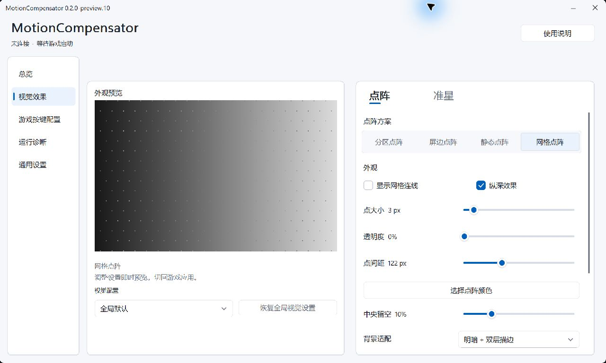
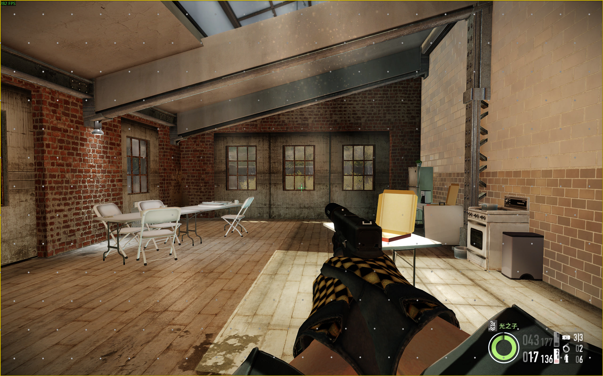
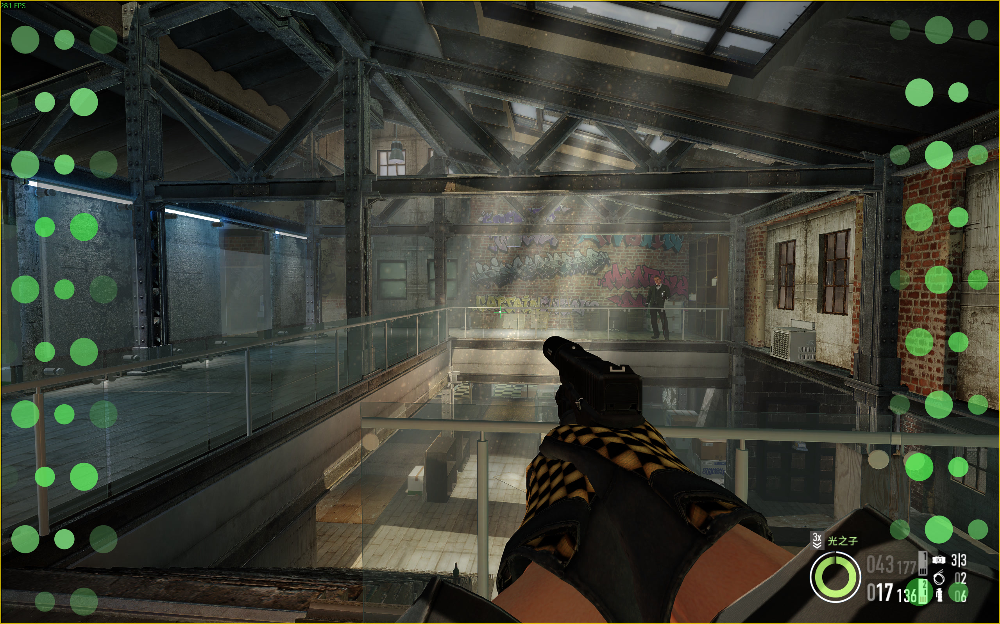
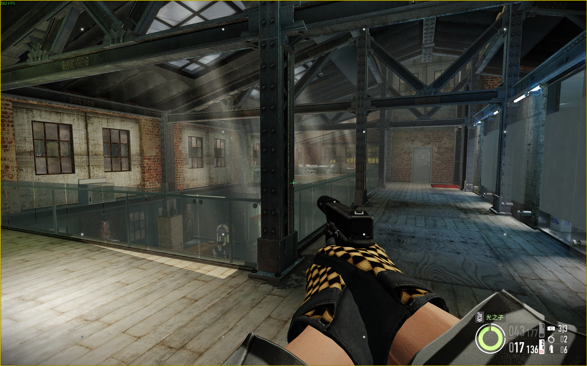
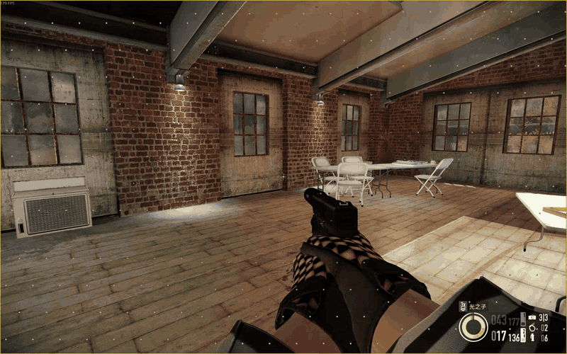

# MotionCompensator

**中文** | [English](README.en.md)

MotionCompensator 是一款用于缓解游戏中晕 3D 和晕动不适的 Windows 视觉辅助工具。它通过可调节的点阵和中央准星提供视觉参照，适合想在游玩时增加视觉参照的玩家。

**Windows x64 · 0.2.0-preview.10 预览版**

[下载 Windows 预览包](https://github.com/gzz312/MotionCompensator/releases/download/v0.2.0-preview.10/MotionCompensator-0.2.0-preview.10-win-x64.zip) · [发布说明与校验值](https://github.com/gzz312/MotionCompensator/releases/tag/v0.2.0-preview.10)

## 设置界面

从「总览」连接游戏。在「视觉效果」选择点阵方案、调整外观，或为游戏保存单独配置。「游戏按键配置」可录入游戏动作键及菜单或背包规则。



[查看内置使用说明](assets/ui/preview.10/user-guide-zh.jpg)

## 选择点阵

- **静态点阵**提供固定的 4×4 参照点，可调整整体覆盖范围。
- **屏边点阵**把动态圆点放在选定的屏幕边缘，为准星、字幕或游戏界面留出空间。
- **分区点阵**让屏幕九个区域分别响应局部运动，可用边界淡化柔化交界。
- **网格点阵**让点阵连续跨区域移动，根据局部间距补充或回收节点。可选的纵深效果通过颜色和大小区分画面扩张与收缩。

四种方案可分别调整外观，动态方案可调整运动强度和方向。背景适配提供明暗变化与双层描边。中央准星可以单独设置形状、大小、颜色和透明度。

## 实机演示（0.1.0-preview.1）

《收获日2》中的三种点阵效果，点击图片可查看大图。颜色、点大小和透明度均可按喜好调整。

| 分区点阵 | 屏边点阵 | 静态点阵（4×4） |
| --- | --- | --- |
|  |  |  |

**分区点阵动态演示（25帧/秒，约3秒）：**



GIF经过缩放和压缩，用于展示点阵外观与运动方式。详细拍摄参数见[素材说明](assets/demo/README.md)。

## 开始使用

1. 解压预览包后运行 `MotionCompensator.exe`。在游戏中优先使用无边框或窗口模式。
2. 在「总览」刷新窗口列表，选择游戏后点「登记并连接」。开启「自动连接已登记游戏」后，程序会在已登记游戏下次切到前台时连接。只想连接本次，可选「临时连接」。
3. 在「视觉效果」调整点阵或准星，再切回游戏查看浮层。可在外观预览下方选择全局默认或某款游戏的配置。
4. 在「通用设置」切换中英文、主题或修改快捷键。可在「游戏按键配置」设置菜单开启和返回键，让浮层在菜单期间隐藏、暂停或暂时显示静态点阵。

| 默认快捷键 | 功能 |
| --- | --- |
| Ctrl+Alt+F8 | 切换点阵方案 |
| Ctrl+Alt+F9 | 显示或隐藏浮层 |
| Ctrl+Alt+F10 | 停止采集和自动连接 |

## 兼容性与反馈

软件通过 Windows Graphics Capture 采集所选窗口，在本机结合光流与键鼠或手柄输入预测。低纹理路面、大片天空、切镜和前景遮挡会减少可用的运动观测。可先在同一场景比较各点阵方案，选择最舒适的一种。[已知问题](docs/KNOWN-ISSUES.md)

「运行诊断」显示采集、运动和网格统计。需要反馈时可以勾选「日志」，复现后关闭。日志位于 EXE 旁的 `logs/` 文件夹。提交反馈时请附上软件版本、游戏、窗口模式、显示缩放和复现步骤。[提交 Issue](https://github.com/gzz312/MotionCompensator/issues) · [本地数据与隐私](docs/PRIVACY.md)

## 使用许可

本项目采用[源码公开与商业集成许可](LICENSE.txt)：允许免费使用、学习、修改和分享，也允许注明出处后集成到具有独立实质功能的商业作品中；禁止独立售卖、换皮售卖及单独收费解锁本项目功能。

分发时须保留完整许可并注明 MotionCompensator、作者 gzz312 和来源。完整规则以许可中文正文为准，第三方组件遵守各自许可证。[第三方许可说明](docs/THIRD-PARTY.md)

## 从源码构建

已验证环境为 Windows x64、MSYS2 UCRT64 GCC15.2、CMake、Ninja 和匹配的 OpenCV4.12 静态库；MSVC 构建尚未验证。

```powershell
./build.ps1 -OpenCVRoot '<OpenCV静态安装目录>'
./package.ps1 -OpenCVRoot '<OpenCV静态安装目录>'
```

依赖准备及完整步骤见[构建说明](docs/BUILD.md)。[测试说明](docs/TESTING.md) · [版本记录](docs/HISTORY.md) · [架构说明](docs/DEVELOPMENT.md)

## 参考与致谢

屏边点阵的视觉方案参考了 shsr07（拾荒散人）的 [MotionStabilizer](https://github.com/shsr07/MotionStabilizer)，感谢作者分享设计思路与创意。[作者B站视频](https://www.bilibili.com/video/BV1saKg6XEvg/)

交错排布与周期连续性思路参考了 Miguel Peixoto 的 MotionCues，视觉锚点设计参考了 Peregrine。完整来源与代码比对记录见[设计参考与致谢](docs/CREDITS.md)。
